# MigrationX

  <strong>Find PostgreSQL migration risk before it reaches production.</strong> 
  Rust · PostgreSQL · SQL AST analysis · Disposable database simulation

  

  
  
  
  
  

MigrationX is a Rust-based PostgreSQL migration risk analysis and simulation toolkit. Its goal is to inspect migration SQL, identify structural and locking hazards, exercise migrations in disposable PostgreSQL instances, observe lock contention, and check whether existing application queries remain compatible after a schema change.

The project is being built around one rule: **unverified does not mean safe**. Static findings, runtime observations, unsupported scenarios and verified outcomes have distinct typed statuses.

> [!IMPORTANT]
> **Development status:** MigrationX is an early-stage workspace at version 0.1.0. The contracts, static-analysis and simulator crates contain implementation work, but the CLI is currently only a bootstrap entry point: it parses an optional migration path and initializes crate logging; it does not yet orchestrate the complete analysis/simulation pipeline. Snapshot collection and end-to-end reporting remain integration work. See the [8-week execution roadmap](plan.md).

## What exists in the workspace

| Crate | Responsibility | Current state |
|---|---|---|
| contracts | Versioned data models shared across crates | Implemented schema types and JSON serialization tests |
| static-analyzer | Parse migration SQL with pg_query and emit typed hazard findings | AST traversal and rule implementation present |
| simulator | Run SQL in disposable PostgreSQL and observe locks / query compatibility | Simulation, lock aggregation and runtime-verdict logic present |
| cli | Parse arguments and orchestrate the system | Bootstrap only; end-to-end orchestration is not wired yet |

## Architecture

The intended end-to-end flow combines two independent evidence paths: static SQL analysis and runtime simulation. Both produce typed contracts so the final report can preserve what was detected, observed, passed or left unverified.

### Crate boundaries

~~~text
                         migrationx-cli
                         /             \
                        v               v
              static-analyzer        simulator
                        \               /
                         v             v
                       contracts
~~~

- **contracts** is the shared schema boundary. It owns versioned types and serialization, not business logic or I/O.
- **static-analyzer** owns PostgreSQL AST parsing and hazard rules. It does not manage containers or format CLI output.
- **simulator** owns disposable database lifecycle, lock observation, and post-migration query checks. It does not own SQL hazard rules.
- **cli** is intended to remain a thin orchestration and presentation layer.

## Analysis model

### Static analysis

The static analyzer uses pg_query to parse SQL into PostgreSQL AST nodes rather than relying only on text matching. The implementation traverses statements and produces StaticFindings containing typed HazardFinding records.

The architecture and PostgreSQL safety rules focus on hazards such as:

- DDL that can acquire strong locks, including ACCESS EXCLUSIVE.
- Table rewrites and risky column changes.
- CREATE INDEX CONCURRENTLY, DROP INDEX CONCURRENTLY and REINDEX CONCURRENTLY transaction-boundary constraints.
- Dynamic SQL / procedural constructs that cannot be fully verified statically.
- Missing lock_timeout and statement_timeout safeguards around DDL.

Static analysis is evidence, not a substitute for runtime verification.

### Disposable PostgreSQL simulation

The simulator crate contains components for:

- Running migration SQL against an ephemeral PostgreSQL instance through testcontainers.
- Running a bounded pool of concurrent application queries during migration execution.
- Sampling pg_locks and pg_stat_activity at a 10 ms default interval.
- Aggregating lock mode, relation, estimated held duration and whether concurrent queries were blocked.
- Running post-migration PREPARE compatibility checks against the supplied N-1 query workload.
- Building a RuntimeVerdict with migration success, duration, lock observations and broken queries.

The simulator's default configuration uses four concurrent worker connections, a 30-second migration timeout and a 10-second per-query preparation timeout. These are crate defaults, not a claim that the full product CLI is ready.

## Verification semantics

MigrationX deliberately keeps five statuses distinct:

| Status | Meaning |
|---|---|
| PASSED | Simulation completed with the required verification inputs and no observed hazard |
| OBSERVED_IN_SIMULATION | Runtime evidence confirmed a migration failure, blocked query or broken compatibility query |
| STATICALLY_DETECTED | A hazard was identified by static SQL analysis |
| COULD_NOT_VERIFY | Evidence was insufficient to establish safety; **this is not a pass** |
| UNSUPPORTED_SCENARIO | The scenario is outside the current analysis capability |

A missing query workload or incomplete verification must not be rendered as safe. This distinction is encoded in VerificationStatus in crates/contracts.

## Data and security boundaries

MigrationX's architecture is designed to analyze production metadata without exporting production rows.

- Target database access is intended to use read-only sessions with SET default_transaction_read_only = on.
- Snapshot data is limited to schema metadata and table statistics; row contents are not part of the Snapshot contract.
- Credentials must be injected through environment variables or a secrets manager and redacted from logs and reports.
- Simulation databases are disposable, use pinned PostgreSQL images, and must not reuse persistent production data.
- Simulation containers are specified to run with restricted networking and explicit CPU, memory and storage limits.
- Container cleanup must happen on success, failure, timeout and cancellation.

These are project security requirements documented in [docs/security/security.md](docs/security/security.md); they should not be interpreted as proof that every end-to-end control is already wired into the current CLI.

## Build and test

Prerequisites: Rust toolchain with Cargo. Docker is required for container-backed simulator tests.

~~~bash
# Check the complete workspace
cargo check --workspace

# Run workspace tests
cargo test --workspace

# Verify formatting
cargo fmt --all -- --check

# Run Clippy with warnings treated as errors
cargo clippy --workspace --all-targets -- -D warnings
~~~

Some simulator tests are explicitly ignored unless Docker is available. A passing unit-test run alone does not prove the full migration workflow is integrated.

## Workspace layout

~~~text
.
├── crates/
│   ├── cli/              # CLI entry point (bootstrap stage)
│   ├── contracts/        # Versioned shared schemas
│   ├── simulator/        # Disposable PostgreSQL simulation
│   └── static-analyzer/  # PostgreSQL AST hazard analysis
├── docs/
│   ├── adr/              # Architecture decision records
│   ├── architecture/     # System design and crate boundaries
│   ├── security/         # Security architecture and threat model
│   └── specifications/   # Detailed technical specifications
├── plan.md               # 8-week parallel execution roadmap
└── Cargo.toml            # Rust workspace
~~~

## Roadmap

The current execution plan is organized into four stages:

1. **Foundation:** freeze shared contracts, build AST hazard detection, add the initial PostgreSQL lock poller and mock CLI outputs.
2. **Scale:** hydrate simulation databases with catalog statistics and prove lock pileups using large-table metadata; establish the deterministic top-20 hazard fixture gate.
3. **Compatibility:** validate N-1 application queries with PostgreSQL PREPARE, split multi-statement / CONCURRENTLY operations correctly, and surface explicit verification states.
4. **Performance and release:** optimize disposable simulation startup, add Expand-Contract remediation recipes, benchmark the workflow and target the v1.0.0 release.

Milestones and acceptance criteria are tracked in [plan.md](plan.md).

## Project documentation

- [System architecture](docs/architecture/architecture.md)
- [Security architecture and threat model](docs/security/security.md)
- [Architecture decision records](docs/adr/)
- [Multi-agent workflow](docs/specifications/multi-agent-workflow.md)
- [8-week execution roadmap](plan.md)

---

  MigrationX · Make migration risk observable before deployment.

