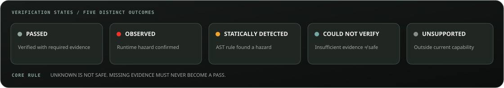

<div align="center">

# MigrationX

**Catch migration risk before it reaches production.**

Rust · PostgreSQL · AST analysis · Disposable database simulation


   

</div>

## The idea

A migration can succeed and still break production.

MigrationX is being built to inspect PostgreSQL changes twice: **read the SQL, then challenge it in a disposable database.** It aims to surface lock risks, table rewrites, blocked queries and compatibility breaks before deployment.

## Two lenses. One verdict.



- **Static analysis** — PostgreSQL AST parsing with `pg_query`; typed hazard findings.
- **Runtime simulation** — disposable PostgreSQL, lock observation and N-1 query compatibility checks.
- **Typed contracts** — preserve what was detected, observed, passed or left unknown.

## Under the hood

| Crate | Owns |
|---|---|
| `contracts` | Versioned shared types and serialization |
| `static-analyzer` | AST traversal and migration hazard rules |
| `simulator` | Disposable database, lock sampling and compatibility checks |
| `cli` | Bootstrap entry point; orchestration is not wired yet |

## Reality check

<sub>EARLY DEVELOPMENT · v0.1.0</sub>

The analyzer, contracts and simulator contain implementation work. **The CLI is currently a bootstrap only** — it does not yet run the complete analysis-to-simulation pipeline. Snapshot collection and end-to-end reporting remain integration work.

> [!CAUTION]
> **Could not verify ≠ safe.** Missing inputs, unsupported SQL or incomplete simulation must never be reported as a clean pass.

## Run it

```bash
cargo check --workspace
cargo test --workspace
cargo fmt --all -- --check
cargo clippy --workspace --all-targets -- -D warnings
```

Docker is required for container-backed simulator tests.

## Explore

[Architecture](docs/architecture/architecture.md) · [Security model](docs/security/security.md) · [Execution roadmap](plan.md) · [ADRs](docs/adr/)

<div align="center">

*MigrationX — make migration risk observable before deployment.*

</div>
